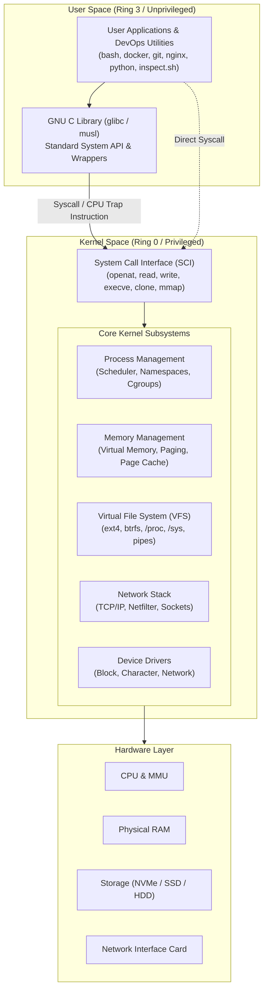

# Linux Architecture: Layered Model

Understanding the boundary between user space and kernel space is fundamental for troubleshooting systems, diagnosing performance issues, and configuring containers and virtualization.

---

## Architecture Diagram (Mermaid)



---

## Architecture Diagram (ASCII Fallback)

```text
+=============================================================================+
|                                 USER SPACE                                  |
|                          (Unprivileged - Ring 3)                            |
|                                                                             |
|  +-----------------------------------------------------------------------+  |
|  | Applications, Daemons & Tools (bash, nginx, docker, python, inspect)  |  |
|  +-----------------------------------------------------------------------+  |
|                                      |                                      |
|                                      v                                      |
|  +-----------------------------------------------------------------------+  |
|  | C Standard Library (glibc / musl API wrappers)                        |  |
|  +-----------------------------------------------------------------------+  |
+=============================================================================+
                                       |
                                       | Syscall / CPU Trap Instruction
                                       v
+=============================================================================+
|                                KERNEL SPACE                                 |
|                           (Privileged - Ring 0)                             |
|                                                                             |
|  +-----------------------------------------------------------------------+  |
|  | System Call Interface (SCI): openat, read, write, clone, execve, etc.  |  |
|  +-----------------------------------------------------------------------+  |
|                                      |                                      |
|       +-------------------+----------+----------+-------------------+       |
|       |                   |                     |                   |       |
|       v                   v                     v                   v       |
|  +-------------+   +---------------+    +---------------+    +------------+ |
|  | Process &   |   | Memory        |    | Virtual File  |    | Network    | |
|  | Scheduling  |   | Management    |    | System (VFS)  |    | Stack      | |
|  | (cgroups,   |   | (Paging, MMU, |    | (ext4, btrfs, |    | (TCP/IP,   | |
|  | namespaces) |   | Swap)         |    | /proc, /sys)  |    | Netfilter) | |
|  +-------------+   +---------------+    +---------------+    +------------+ |
|       |                   |                     |                   |       |
|       +-------------------+----------+----------+-------------------+       |
|                                      |                                      |
|                                      v                                      |
|  +-----------------------------------------------------------------------+  |
|  | Device Drivers (Disk, Network, Display, Bus, Character, Block)       |  |
|  +-----------------------------------------------------------------------+  |
+=============================================================================+
                                       |
                                       v
+=============================================================================+
|                               HARDWARE LAYER                                |
|                  (CPU, Memory/MMU, Disks, Network Cards)                    |
+=============================================================================+
```

---

## Architectural Boundaries Explained

1. **User Space vs. Kernel Space**:
   - **User space** executes in unprivileged CPU ring (x86 Ring 3). Code running here cannot directly access hardware registers, physical devices, or raw kernel memory.
   - **Kernel space** executes in highest privilege (x86 Ring 0). The kernel manages core hardware, arbitrates access, and schedules processes.
2. **System Call Interface (SCI)**:
   - The strictly defined transition point between user programs and the kernel. An application issues an interrupt/syscall instruction to request system resources (reading files, dispatching network packets, spawning processes).
3. **Pseudo-Filesystems (`/proc` and `/sys`)**:
   - The Virtual File System (VFS) abstracts kernel internals as directory structures:
     - `/proc` exposes live process structures and system runtime state.
     - `/sys` exposes kernel device trees, buses, drivers, and class hierarchies.
