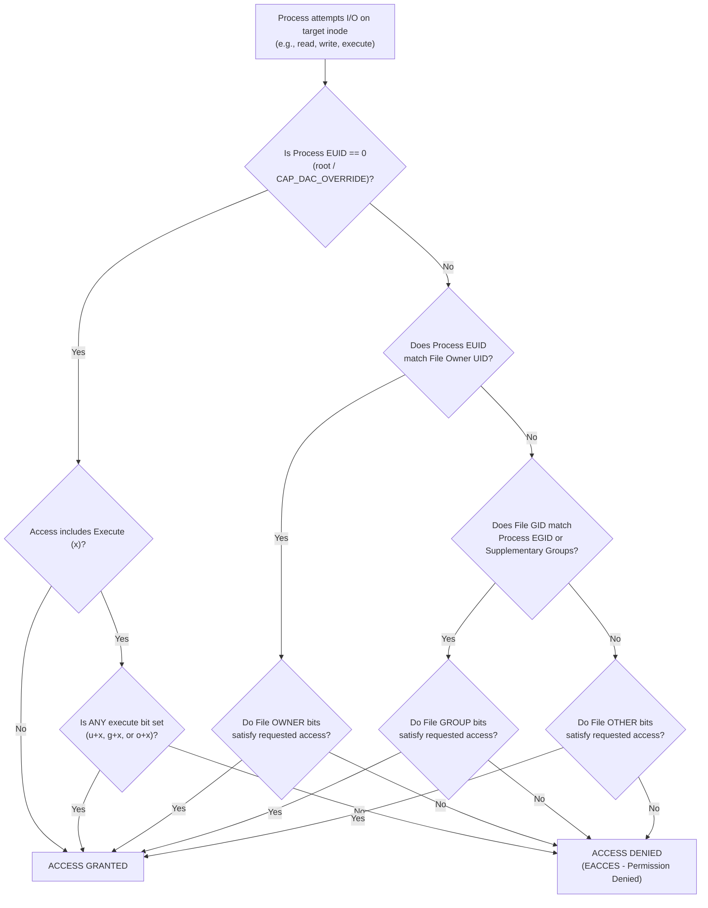

# Linux Kernel Permission Check: How Access is Evaluated

Understanding the exact algorithm the Linux kernel uses to grant or deny access to files and directories is critical for system administration, container security, and debugging permission denied errors.

---

## Permission Evaluation Algorithm

When a process requests access (read `r`, write `w`, execute `x`) to an inode:

1. **Root Bypass (CAP_DAC_OVERRIDE / CAP_DAC_READ_SEARCH):**
   - If the effective UID is `0` (root), read and write permissions are automatically granted on any file.
   - For execute permission, root is granted access if at least one execute bit (`u+x`, `g+x`, or `o+x`) is set on the file.
2. **First Match Wins (Owner vs Group vs Other):**
   - **Step A (Owner Check):** If the process's effective UID matches the file's owner UID, **only** the owner permission bits are evaluated. Group and other bits are completely ignored!
     - *Key Implication:* If the owner bits deny access (e.g. `----rwxrwx` / `0077`), the owner is immediately denied `Permission denied`, even though group and others have full permissions.
   - **Step B (Group Check):** If UID does not match, but the file's GID matches the process's effective GID or any of its supplementary groups, **only** the group permission bits are evaluated. Other bits are ignored!
   - **Step C (Other Check):** If neither UID nor any GID matches, the `other` (world) permission bits are evaluated.
3. **Directory Traversal Requirement:**
   - Access to any file or subdirectory requires execute (`x`) permission on **every single ancestor directory** along the entire path from root (`/`) down to the target object.
   - Read (`r`) on a directory allows listing names in that directory (e.g. `ls`), but without execute (`x`), inodes cannot be stat'd, opened, or traversed (`cd`).

---

## Kernel Permission Check Flowchart (Mermaid)



---

## Kernel Permission Check Diagram (ASCII Fallback)

```text
+=============================================================================+
|                      PROCESS ATTEMPTS ACCESS TO INODE                       |
+=============================================================================+
                                       |
                                       v
                    +-------------------------------------+
                    | Is process root (EUID == 0)?        |
                    +-------------------------------------+
                         /                           \
                   YES  /                             \  NO
                       v                               v
         +---------------------------+    +---------------------------------+
         | Is access execute (x)?    |    | Does process EUID match Owner?  |
         +---------------------------+    +---------------------------------+
            /                     \                    /               \
       NO  /                       \ YES         YES  /                 \ NO
          v                         v                v                   v
     [GRANTED]         +--------------------+  +-----------+    +---------------+
                       | Any 'x' bit set?   |  | Check     |    | Does File GID |
                       +--------------------+  | OWNER     |    | match primary |
                          /              \     | bits      |    | or supplement |
                     YES /                \ NO +-----------+    | groups?       |
                        v                  v     /       \      +---------------+
                    [GRANTED]           [DENIED]/         \         /        \
                                               v           v   YES /          \ NO
                                           [GRANTED]   [DENIED]   v            v
                                                            +-----------+ +-----------+
                                                            | Check     | | Check     |
                                                            | GROUP     | | OTHER     |
                                                            | bits      | | bits      |
                                                            +-----------+ +-----------+
                                                              /       \     /       \
                                                             v         v   v         v
                                                         [GRANTED]  [DENIED] [GRANT] [DENY]
```

---

## Directory Path Traversal Semantics

For a path such as `/srv/app/config/settings.yaml`:

```text
/                  -> Requires +x
└── srv/           -> Requires +x
    └── app/       -> Requires +x
        └── config/       -> Requires +x (plus +w if creating/deleting inside)
            └── settings.yaml -> Requires requested access (+r, +w, or +x)
```

- If `/srv/app` is missing `+x` for the calling user, access to `/srv/app/config/settings.yaml` is denied immediately, regardless of permissions on `config/` or `settings.yaml`.
- Deleting or renaming `settings.yaml` depends **entirely on write (`w`) and execute (`x`) permissions of the parent directory `config/`**, not on the file's own write permissions.
