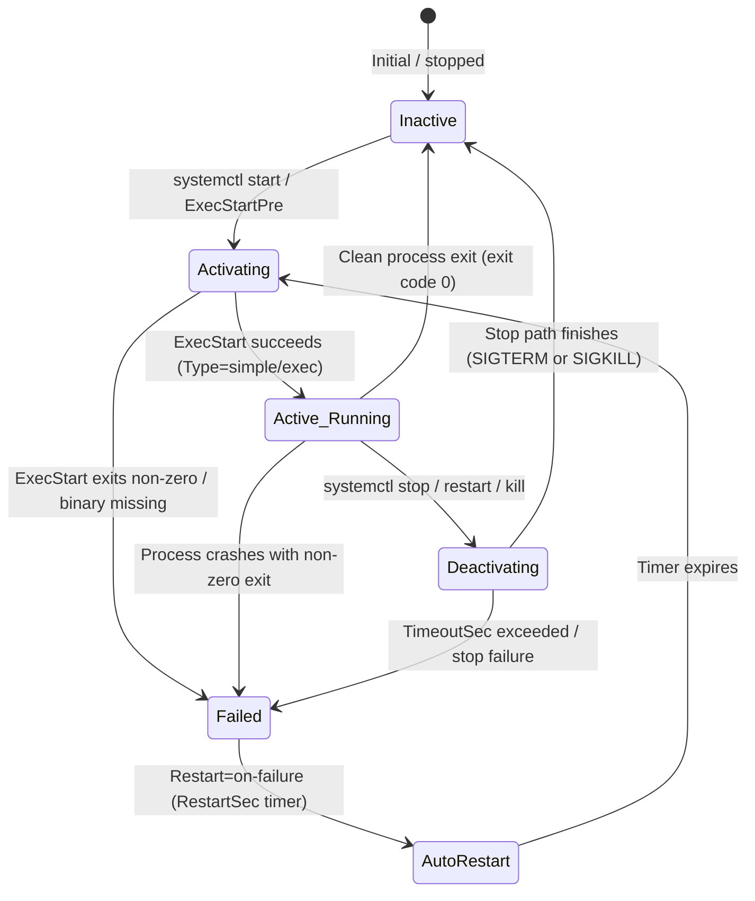
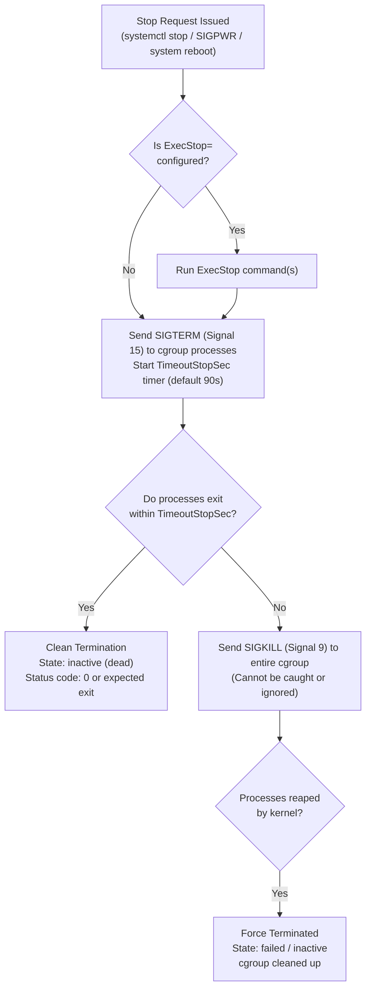

# systemd Service Lifecycle and Process Management

Understanding how systemd transitions services across states and terminates processes is essential for designing resilient microservices, writing production-grade unit files, and diagnosing deployment timeouts or zombie processes.

---

## Service Lifecycle State Transitions

A systemd service moves through defined active and sub-states managed by its control group (cgroup) and process exit codes:



---

## The Two-Stage Stop Path: SIGTERM to SIGKILL

When systemd stops a service (or during shutdown/restart), it executes a standardized, graceful-then-forceful two-stage teardown:



---

## ASCII Fallback Diagram

```text
+=============================================================================+
|                      systemd SERVICE STOP & KILL PATH                       |
+=============================================================================+
                                       |
                                       v
                 +-------------------------------------------+
                 | Stop triggered: systemctl stop <unit>     |
                 +-------------------------------------------+
                                       |
                                       v
                 +-------------------------------------------+
                 | Send SIGTERM (Signal 15) to main PID /    |
                 | all processes inside the unit's cgroup    |
                 | Start TimeoutStopSec timer (e.g., 90s)    |
                 +-------------------------------------------+
                                       |
                   +-------------------+-------------------+
                   |                                       |
         [Process exits within timer]             [Timer expires: timeout]
                   |                                       |
                   v                                       v
     +---------------------------+           +---------------------------+
     | Clean Termination         |           | Send SIGKILL (Signal 9)   |
     | Unit state: inactive      |           | Kernels destroys process  |
     | cgroup cleanly deleted    |           | Unit state: failed/stop   |
     +---------------------------+           +---------------------------+
```

---

## Architectural Principles of systemd Process Tracking

1. **CGroup Tracking (No Escaping via Double Fork):**
   - Traditional init scripts tracked services via PID files (`/var/run/app.pid`). If a rogue daemon or worker fork-bombed or double-forked, orphaned processes escaped init tracking.
   - systemd places every service into its own dedicated control group slice (e.g. `/sys/fs/cgroup/system.slice/myservice.service`). When systemd signals or stops the service, it signals **every PID registered within that cgroup**, preventing orphaned daemon leakage.

2. **Signal Handling Differences:**
   - **SIGTERM (15):** Cooperative graceful shutdown. Handlers catch SIGTERM to close sockets, flush transaction buffers, complete active requests, and write checkpoints.
   - **SIGKILL (9):** Uncatchable kernel-level execution termination. The kernel immediately frees process address space, file descriptors, and CPU allocations.

3. **Restart Policies:**
   - `Restart=no`: Service is never restarted automatically.
   - `Restart=on-failure`: Service restarts if it terminates abnormally (non-zero exit status, fatal signal like SIGKILL/SIGSEGV, or watchdog timeout). Does not restart on clean exit (`exit 0`).
   - `Restart=always`: Re-executes regardless of whether the exit was clean or caused by an unhandled error.
