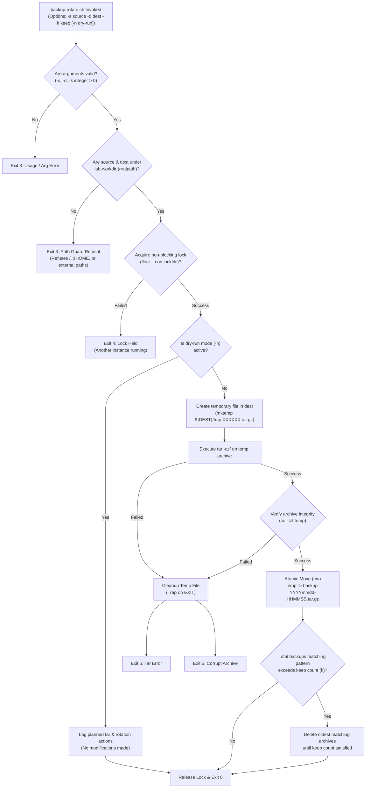

# Backup and Rotation Architecture & Bash Safety Caveats

Automated maintenance scripts form the backbone of reliable operations. However, unhardened Bash scripts risk data loss, race conditions, partial archive corruption, or unbounded disk consumption.

---

## Backup & Rotation Control Flow



---

## Backup Flow Diagram (ASCII Fallback)

```text
+=============================================================================+
|                       backup-rotate.sh CONTROL FLOW                         |
+=============================================================================+
                                       |
                                       v
         +-----------------------------------------------------------+
         | 1. Argument Parsing & Validation (-s, -d, -k, -n)         |
         +-----------------------------------------------------------+
                                       |
                                       v
         +-----------------------------------------------------------+
         | 2. Path Guards (realpath resolves strictly under workdir) |
         +-----------------------------------------------------------+
                                       |
                                       v
         +-----------------------------------------------------------+
         | 3. Concurrency Lock (flock -n on tmp/backup.lock)         |
         +-----------------------------------------------------------+
                                       |
                     +-----------------+-----------------+
                     |                                   |
              [Dry-run active]                   [Real Execution]
                     |                                   |
                     v                                   v
         +-----------------------+           +-----------------------+
         | Log planned actions   |           | 4. Create mktemp file |
         | Perform no I/O        |           | in destination dir    |
         +-----------------------+           +-----------------------+
                     |                                   |
                     |                                   v
                     |                       +-----------------------+
                     |                       | 5. tar -czf to temp   |
                     |                       +-----------------------+
                     |                                   |
                     |                                   v
                     |                       +-----------------------+
                     |                       | 6. tar -tzf verify    |
                     |                       +-----------------------+
                     |                                   |
                     |                                   v
                     |                       +-----------------------+
                     |                       | 7. Atomic mv to final |
                     |                       | backup-timestamp.tar.gz
                     |                       +-----------------------+
                     |                                   |
                     |                                   v
                     |                       +-----------------------+
                     |                       | 8. Rotate: delete     |
                     |                       | oldest archives > k   |
                     |                       +-----------------------+
                     |                                   |
                     +-----------------+-----------------+
                                       |
                                       v
         +-----------------------------------------------------------+
         | 9. Release lock, trap cleanup temp, exit 0                |
         +-----------------------------------------------------------+
```

---

## Safety Options: Best Practices and Caveats

| Option / Setting | Intended Behavior | Operational Caveats & Why "Blind" Use is Dangerous | DevOps Best Practice |
| :--- | :--- | :--- | :--- |
| **`set -e`** | Immediately aborts the script if any command exits with a non-zero code. | **False sense of security:** `set -e` is ignored inside subshells, `if` conditions, `while` tests, pipelines (unless `pipefail` is set), and arithmetic `(( count++ ))` when count is 0. It often causes sudden silent exits without proper error logs or cleanup. | Use `set -uo pipefail`, handle expected non-zero exits explicitly (`cmd \|\| die "msg"`), and use cleanup `trap`. |
| **`set -u`** | Treats unreferenced or unset variables as an error, refusing execution. | Catches catastrophic bugs such as `rm -rf "${BACKUP_DIR}/"` expanding to `rm -rf "/"` if `BACKUP_DIR` was unset. Caveat: Breaks default array checks (`"${ARRAY[@]}"` on older bash) or optional flags unless checked with `${VAR:-}`. | Always enable `set -u`. Use parameter expansion defaults (`${1:-default}`) for optional variables. |
| **`set -o pipefail`** | Returns the exit status of the last command in a pipeline that failed, rather than always returning the status of the final command. | In `curl http://badurl \| jq .`, without `pipefail`, the pipeline exits `0` because `jq` exited `0`, hiding the network download failure. | Always enable `pipefail` for any script that processes streamed or piped data. |
| **`mktemp` & Atomic `mv`** | Writes archive to a temporary file, verifies it, then moves it to the target name. | If a script writes directly to `backup.tar.gz` and the disk fills up or the process is killed midway, a corrupt 0-byte or truncated file is left behind and considered "valid" by name. | Always write to a temporary file on the same filesystem, verify contents, and rename atomically. |
| **Non-blocking `flock`** | Acquires a kernel file lock before starting work. | Cron jobs or timer units that run longer than their interval will pile up concurrently, multiplying CPU/disk load (thundering herd problem). | Always use `flock -n` to exit gracefully if a previous run is still active. |
